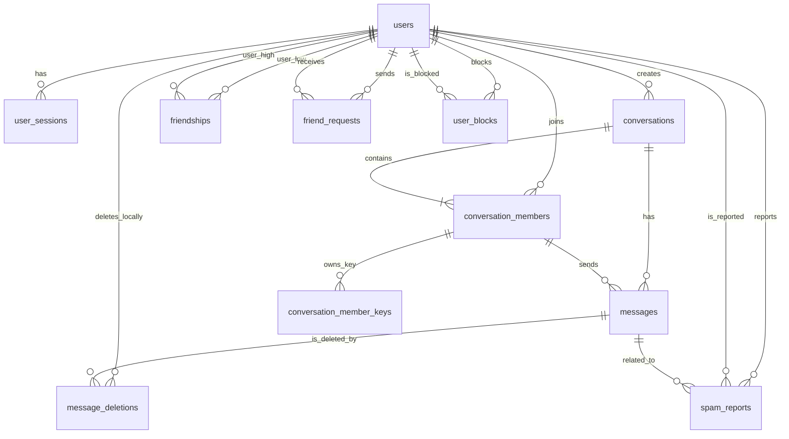

# TÀI LIỆU THIẾT KẾ CƠ SỞ DỮ LIỆU (DATABASE DESIGN SPECIFICATION)
**Đồ án:** Hệ thống Chat (Chat System)  
**Môn học:** Lập trình ứng dụng Java - BM. Công nghệ phần mềm, Khoa CNTT, Trường ĐH KHTN (HCMUS)  
**Hệ quản trị CSDL:** MySQL 8.0+ / MariaDB 10.5+ (Bảng mã: `utf8mb4_unicode_ci`)  
**Tài liệu tham khảo sơ đồ:** [docs/chat_system_schema_v2.dbml](file:///d:/Y2-Se2/Y3-SE1/JAVA/FINAL PROJECT CODE/REPO/docs/chat_system_schema_v2.dbml)  

---

## 1. Tổng quan thiết kế & Sơ đồ quan hệ thực thể (ERD)

Cơ sở dữ liệu được thiết kế gồm **11 bảng chuẩn hóa** và **1 VIEW logic**, đáp ứng đầy đủ 9 yêu cầu của phân hệ Quản trị viên và 12 yêu cầu của phân hệ Người dùng, đảm bảo chuẩn hóa bậc 3 (3NF) và tối ưu hóa tốc độ truy vấn thống kê biểu đồ.



---

## 2. Từ điển dữ liệu chi tiết (Data Dictionary)

### 2.1. Bảng `users` (Tài khoản người dùng và quản trị viên)
Lưu trữ thông tin hồ sơ của cả hai đối tượng Người dùng và Quản trị viên (phân biệt qua cột `role`).

| Tên cột | Kiểu dữ liệu | Khóa | Ràng buộc | Mô tả ý nghĩa |
| :--- | :--- | :---: | :---: | :--- |
| `user_id` | `INT` | **PK** | AUTO_INCREMENT | Mã định danh duy nhất của người dùng |
| `username` | `VARCHAR(30)` | | NOT NULL, UNIQUE | Tên đăng nhập (chỉ chứa chữ cái, số, dấu chấm/gạch dưới) |
| `password_hash` | `VARCHAR(255)` | | NOT NULL | Chuỗi mật khẩu đã băm một chiều an toàn (BCrypt / SHA-256) |
| `must_change_password` | `BOOLEAN` | | DEFAULT FALSE | Đánh dấu người dùng phải đổi mật khẩu ở lần đăng nhập tới (khi reset pass qua email) |
| `full_name` | `VARCHAR(100)` | | NOT NULL | Họ và tên đầy đủ |
| `email` | `VARCHAR(254)` | | NOT NULL, UNIQUE | Địa chỉ thư điện tử dùng để nhận mật khẩu ngẫu nhiên |
| `address` | `VARCHAR(255)` | | NULL | Địa chỉ cư trú |
| `date_of_birth` | `DATE` | | NULL | Ngày tháng năm sinh |
| `gender` | `ENUM` | | 'MALE', 'FEMALE', 'OTHER' | Giới tính |
| `account_status` | `ENUM` | | 'ACTIVE', 'LOCKED' | Trạng thái tài khoản (Hoạt động / Bị khóa do vi phạm hoặc do admin) |
| `role` | `ENUM` | | 'USER', 'ADMIN' | Phân quyền tài khoản trong hệ thống |
| `public_key` | `TEXT` | | NULL | Khóa công khai RSA/ECC sinh từ Client phục vụ trao đổi khóa mã hóa nhóm |
| `encrypted_private_key` | `TEXT` | | NULL | Khóa riêng tư đã mã hóa bảo vệ (Client-side encrypted) |
| `created_at` | `TIMESTAMP` | | DEFAULT CURRENT_TIMESTAMP | Thời điểm đăng ký tài khoản (dùng vẽ biểu đồ tăng trưởng) |
| `updated_at` | `TIMESTAMP` | | ON UPDATE CURRENT_TIMESTAMP | Thời điểm cập nhật thông tin gần nhất |
| `deleted_at` | `TIMESTAMP` | | NULL | Thời điểm xóa tài khoản (Áp dụng cơ chế Soft Delete) |

* **Chỉ mục (Indexes):** `idx_users_full_name (full_name)`, `idx_users_created_at (created_at)`, `idx_users_status_created (account_status, created_at)`.

---

### 2.2. Bảng `user_sessions` (Phiên đăng nhập & Lịch sử hoạt động)
Mỗi lần người dùng mở ứng dụng và đăng nhập thành công sẽ tạo 1 dòng ghi nhận phiên.

| Tên cột | Kiểu dữ liệu | Khóa | Ràng buộc | Mô tả ý nghĩa |
| :--- | :--- | :---: | :---: | :--- |
| `session_id` | `BIGINT` | **PK** | AUTO_INCREMENT | Mã phiên đăng nhập |
| `user_id` | `INT` | **FK** | REFERENCES `users(user_id)` | Người dùng thực hiện đăng nhập |
| `login_at` | `TIMESTAMP` | | DEFAULT CURRENT_TIMESTAMP | Thời gian đăng nhập (phục vụ chức năng 2 và biểu đồ mở app của Admin) |
| `last_seen_at` | `TIMESTAMP` | | DEFAULT CURRENT_TIMESTAMP | Mốc thời gian tương tác cuối (cập nhật qua Heartbeat định kỳ 30-60s) |
| `logout_at` | `TIMESTAMP` | | NULL | Thời điểm đăng xuất (NULL nếu đang mở ứng dụng) |

* **Xác định trạng thái Online:** Một user đang Online khi có session với `logout_at IS NULL` và `last_seen_at >= NOW() - INTERVAL 1 MINUTE`.

---

### 2.3. Bảng `conversations` (Cuộc trò chuyện 1-1 và Nhóm chat)

| Tên cột | Kiểu dữ liệu | Khóa | Ràng buộc | Mô tả ý nghĩa |
| :--- | :--- | :---: | :---: | :--- |
| `conversation_id` | `INT` | **PK** | AUTO_INCREMENT | Mã cuộc trò chuyện |
| `conversation_type` | `ENUM` | | 'DIRECT', 'GROUP' | Phân loại: Chat 1-1 hoặc Chat Nhóm |
| `title` | `VARCHAR(100)` | | NULL | Tên nhóm chat (NULL nếu là chat 1-1) |
| `created_by_user_id` | `INT` | **FK** | REFERENCES `users(user_id)` | Người khởi tạo cuộc trò chuyện/nhóm |
| `direct_user_low_id` | `INT` | **FK** | NULL, UNIQUE cặp | ID người dùng nhỏ hơn trong cặp chat 1-1 |
| `direct_user_high_id`| `INT` | **FK** | NULL, UNIQUE cặp | ID người dùng lớn hơn trong cặp chat 1-1 |
| `is_encrypted` | `BOOLEAN` | | DEFAULT FALSE | Đánh dấu nhóm có bật tính năng mã hóa E2EE |
| `current_key_version`| `INT` | | DEFAULT 0 | Phiên bản khóa đối xứng hiện hành (tăng lên khi xóa thành viên) |
| `created_at` | `TIMESTAMP` | | DEFAULT CURRENT_TIMESTAMP | Thời điểm tạo cuộc trò chuyện/nhóm |
| `updated_at` | `TIMESTAMP` | | ON UPDATE CURRENT_TIMESTAMP | Thời điểm có tin nhắn mới hoặc cập nhật tên nhóm |

* **Ràng buộc toàn vẹn (CHECK):**
  - Chat 1-1: Bắt buộc `direct_user_low_id < direct_user_high_id` và khác NULL.
  - Chat nhóm: Bắt buộc `direct_user_low_id` và `direct_user_high_id` đều là NULL.

---

### 2.4. Bảng `conversation_members` (Thành viên cuộc trò chuyện)

| Tên cột | Kiểu dữ liệu | Khóa | Ràng buộc | Mô tả ý nghĩa |
| :--- | :--- | :---: | :---: | :--- |
| `conversation_id` | `INT` | **PK, FK**| REFERENCES `conversations` | Mã cuộc trò chuyện |
| `user_id` | `INT` | **PK, FK**| REFERENCES `users` | Mã người dùng tham gia |
| `member_role` | `ENUM` | | 'MEMBER', 'ADMIN' | Quyền trong nhóm (Admin nhóm mới được đổi tên, thêm/xóa thành viên) |
| `joined_at` | `TIMESTAMP` | | DEFAULT CURRENT_TIMESTAMP | Thời điểm tham gia nhóm |
| `left_at` | `TIMESTAMP` | | NULL | Thời điểm rời hoặc bị xóa khỏi nhóm (Soft delete thành viên) |
| `history_cleared_at`| `TIMESTAMP` | | NULL | Mốc thời điểm người dùng bấm "Xóa toàn bộ lịch sử chat" |
| `last_read_at` | `TIMESTAMP` | | NULL | Mốc tin nhắn đọc cuối (dùng đếm số tin nhắn chưa đọc khi offline) |

---

### 2.5. Bảng `messages` (Tin nhắn trao đổi)

| Tên cột | Kiểu dữ liệu | Khóa | Ràng buộc | Mô tả ý nghĩa |
| :--- | :--- | :---: | :---: | :--- |
| `message_id` | `BIGINT` | **PK** | AUTO_INCREMENT | Mã định danh tin nhắn |
| `conversation_id` | `INT` | **FK** | Khóa ghép cùng sender_id | Thuộc cuộc trò chuyện nào |
| `sender_id` | `INT` | **FK** | Khóa ghép cùng conv_id | Người gửi tin nhắn (phải là thành viên cuộc trò chuyện) |
| `content` | `TEXT` | | NOT NULL, FULLTEXT | Nội dung tin nhắn (hoặc bản mã Base64 nếu nhóm mã hóa) |
| `key_version` | `INT` | | NULL | Phiên bản khóa dùng để giải mã (với nhóm mã hóa) |
| `nonce` | `VARCHAR(64)` | | NULL | Giá trị IV/Nonce 12-byte dùng trong AES-256-GCM |
| `sent_at` | `TIMESTAMP` | | DEFAULT CURRENT_TIMESTAMP | Thời điểm gửi tin nhắn |
| `edited_at` | `TIMESTAMP` | | NULL | Thời điểm chỉnh sửa tin nhắn |

* **Tìm kiếm toàn văn (FULLTEXT):** Đánh chỉ mục `FULLTEXT (content)` hỗ trợ tìm kiếm tin nhắn siêu nhanh (chức năng 11f, 11g trong PDF).

---

### 2.6. Bảng `message_deletions` (Xóa cục bộ từng tin nhắn)
Giải quyết yêu cầu: **"Xóa 1 hoặc vài dòng trong lịch sử chat"** của người dùng mà không làm mất tin nhắn của đối phương.

| Tên cột | Kiểu dữ liệu | Khóa | Ràng buộc | Mô tả ý nghĩa |
| :--- | :--- | :---: | :---: | :--- |
| `message_id` | `BIGINT` | **PK, FK**| REFERENCES `messages` (CASCADE) | Tin nhắn bị ẩn |
| `user_id` | `INT` | **PK, FK**| REFERENCES `users` (CASCADE) | Người dùng chọn ẩn tin nhắn này |
| `deleted_at` | `TIMESTAMP` | | DEFAULT CURRENT_TIMESTAMP | Thời điểm thực hiện ẩn |

---

### 2.7. Bảng `friendships` (Quan hệ bạn bè hai chiều)

| Tên cột | Kiểu dữ liệu | Khóa | Ràng buộc | Mô tả ý nghĩa |
| :--- | :--- | :---: | :---: | :--- |
| `user_low_id` | `INT` | **PK, FK**| REFERENCES `users` | ID người dùng nhỏ hơn trong cặp bạn |
| `user_high_id`| `INT` | **PK, FK**| REFERENCES `users` | ID người dùng lớn hơn trong cặp bạn |
| `created_at` | `TIMESTAMP` | | DEFAULT CURRENT_TIMESTAMP | Thời điểm kết bạn thành công |

* **Ràng buộc:** `CHECK (user_low_id < user_high_id)`. Mỗi quan hệ bạn bè chỉ lưu đúng 1 dòng duy nhất.
* **VIEW hỗ trợ (`friend_edges`):**
  ```sql
  CREATE VIEW friend_edges AS
  SELECT user_low_id AS user_id, user_high_id AS friend_id FROM friendships
  UNION ALL
  SELECT user_high_id AS user_id, user_low_id AS friend_id FROM friendships;
  ```

---

### 2.8. Bảng `friend_requests` (Lời mời kết bạn)

| Tên cột | Kiểu dữ liệu | Khóa | Ràng buộc | Mô tả ý nghĩa |
| :--- | :--- | :---: | :---: | :--- |
| `request_id` | `INT` | **PK** | AUTO_INCREMENT | Mã lời mời |
| `sender_id` | `INT` | **FK** | REFERENCES `users` | Người gửi lời mời kết bạn |
| `receiver_id` | `INT` | **FK** | REFERENCES `users` | Người nhận lời mời kết bạn |
| `status` | `ENUM` | | 'PENDING', 'ACCEPTED', 'REJECTED' | Trạng thái lời mời |
| `created_at` | `TIMESTAMP` | | DEFAULT CURRENT_TIMESTAMP | Thời điểm gửi lời mời |
| `responded_at`| `TIMESTAMP` | | NULL | Thời điểm phản hồi (đồng ý/từ chối) |

---

### 2.9. Bảng `user_blocks` (Danh sách chặn tài khoản)

| Tên cột | Kiểu dữ liệu | Khóa | Ràng buộc | Mô tả ý nghĩa |
| :--- | :--- | :---: | :---: | :--- |
| `blocker_user_id` | `INT` | **PK, FK**| REFERENCES `users` | Người thực hiện chặn |
| `blocked_user_id` | `INT` | **PK, FK**| REFERENCES `users` | Người bị chặn |
| `created_at` | `TIMESTAMP` | | DEFAULT CURRENT_TIMESTAMP | Thời điểm thiết lập chặn |

* Khi tìm kiếm người dùng: Câu query tự động loại trừ `WHERE user_id NOT IN (SELECT blocker_user_id FROM user_blocks WHERE blocked_user_id = :my_id)`.

---

### 2.10. Bảng `spam_reports` (Báo cáo vi phạm & spam)

| Tên cột | Kiểu dữ liệu | Khóa | Ràng buộc | Mô tả ý nghĩa |
| :--- | :--- | :---: | :---: | :--- |
| `report_id` | `INT` | **PK** | AUTO_INCREMENT | Mã báo cáo |
| `reporter_user_id`| `INT` | **FK** | REFERENCES `users` | Người gửi báo cáo tố cáo |
| `reported_user_id`| `INT` | **FK** | REFERENCES `users` | Người bị tố cáo |
| `related_message_id`| `BIGINT` | **FK** | NULL, REFERENCES `messages` | Tin nhắn bằng chứng vi phạm (nếu có) |
| `reason` | `TEXT` | | NULL | Lý do báo cáo vi phạm |
| `status` | `ENUM` | | 'OPEN', 'REVIEWED', 'DISMISSED' | Trạng thái xử lý của Admin |
| `created_at` | `TIMESTAMP` | | DEFAULT CURRENT_TIMESTAMP | Thời điểm gửi báo cáo |
| `handled_by_user_id`| `INT` | **FK** | NULL, REFERENCES `users` | Quản trị viên xử lý báo cáo |
| `handled_at` | `TIMESTAMP` | | NULL | Thời điểm xử lý xong |

---

### 2.11. Bảng `conversation_member_keys` (Quản lý khóa nhóm mã hóa E2EE)

| Tên cột | Kiểu dữ liệu | Khóa | Ràng buộc | Mô tả ý nghĩa |
| :--- | :--- | :---: | :---: | :--- |
| `conversation_id` | `INT` | **PK, FK**| REFERENCES `conversation_members` | Mã nhóm chat |
| `user_id` | `INT` | **PK, FK**| REFERENCES `conversation_members` | Mã thành viên nhận khóa |
| `key_version` | `INT` | **PK** | NOT NULL | Phiên bản khóa nhóm |
| `encrypted_group_key`| `TEXT` | | NOT NULL | Khóa AES của nhóm đã được bọc bằng Public Key của user này |
| `created_at` | `TIMESTAMP` | | DEFAULT CURRENT_TIMESTAMP | Thời điểm cấp khóa |

---

## 3. Các truy vấn SQL quan trọng giải quyết yêu cầu đồ án

### 3.1. Tính số lượng bạn bè trực tiếp & "Bạn của bạn" (Yêu cầu Admin số 7)
```sql
SELECT 
    u.user_id,
    u.username,
    u.full_name,
    -- Số lượng bạn trực tiếp:
    COUNT(DISTINCT direct.friend_id) AS direct_friends_count,
    -- Số lượng tính luôn "bạn của bạn" (không tính chính mình và không trùng lặp):
    COUNT(DISTINCT fof.friend_id) AS total_network_count
FROM users u
LEFT JOIN friend_edges direct ON u.user_id = direct.user_id
LEFT JOIN friend_edges fof ON direct.friend_id = fof.user_id AND fof.friend_id <> u.user_id
WHERE u.deleted_at IS NULL
GROUP BY u.user_id, u.username, u.full_name;
```

### 3.2. Lấy lịch sử tin nhắn của một người trong cuộc trò chuyện (Yêu cầu User số 11c, 11d, 11e)
```sql
SELECT m.* 
FROM messages m
JOIN conversation_members cm 
     ON cm.conversation_id = m.conversation_id AND cm.user_id = :current_user_id
WHERE m.conversation_id = :target_conversation_id
  -- Không thấy tin nhắn gửi trước thời điểm tham gia nhóm:
  AND m.sent_at >= cm.joined_at
  -- Không thấy tin nhắn nếu đã rời nhóm:
  AND (cm.left_at IS NULL OR m.sent_at <= cm.left_at)
  -- Không thấy tin nhắn trước thời điểm người dùng tự bấm "Xóa toàn bộ lịch sử":
  AND (cm.history_cleared_at IS NULL OR m.sent_at > cm.history_cleared_at)
  -- Không hiển thị các tin nhắn người dùng đã bấm "Xóa từng dòng":
  AND NOT EXISTS (
      SELECT 1 FROM message_deletions md 
      WHERE md.message_id = m.message_id AND md.user_id = :current_user_id
  )
ORDER BY m.sent_at ASC;
```

### 3.3. Thống kê số lượng mở ứng dụng và vẽ biểu đồ theo năm (Yêu cầu Admin số 8, 9)
```sql
-- Đếm số người dùng có mở ứng dụng theo từng tháng trong năm :target_year
SELECT 
    MONTH(login_at) AS report_month,
    COUNT(DISTINCT user_id) AS active_users_count
FROM user_sessions
WHERE login_at >= CONCAT(:target_year, '-01-01') 
  AND login_at <  CONCAT(:target_year + 1, '-01-01')
GROUP BY MONTH(login_at)
ORDER BY report_month ASC;
```
